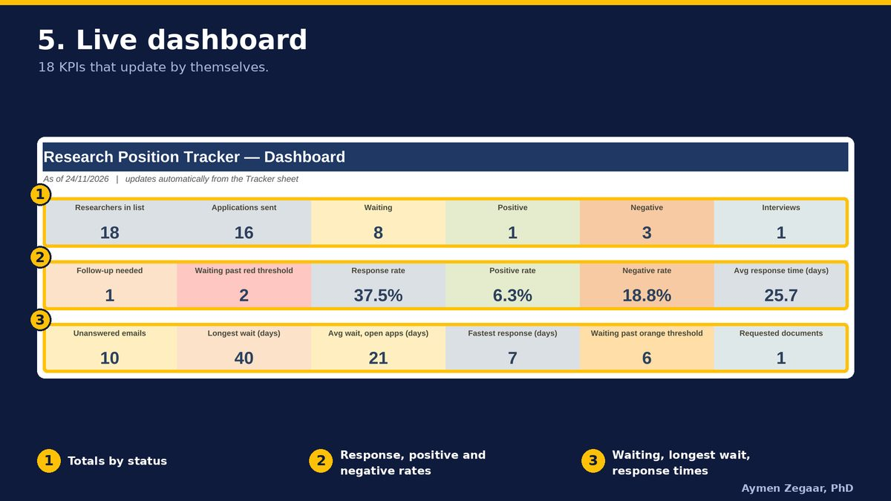
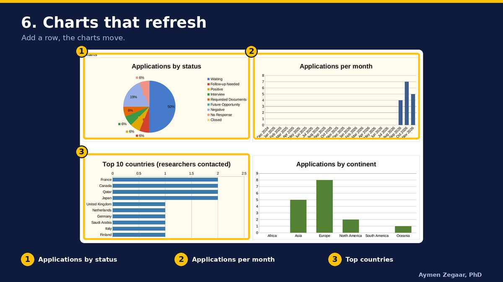
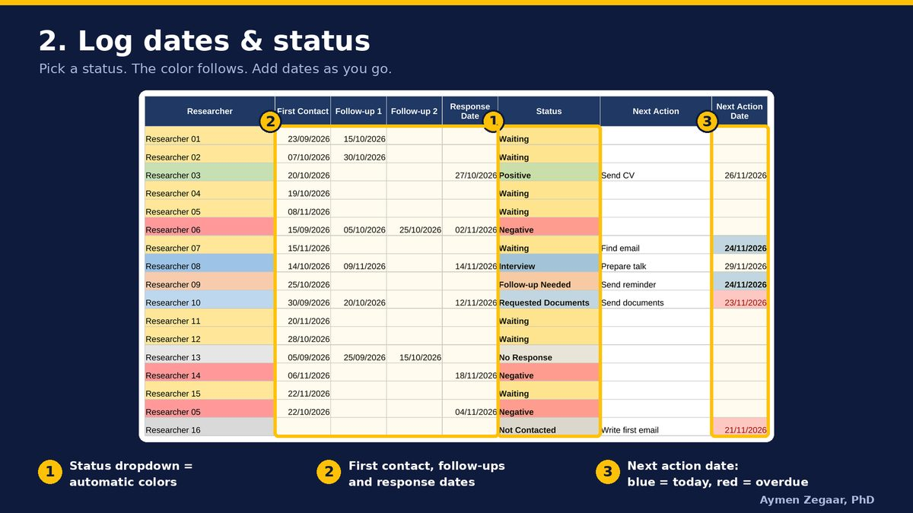
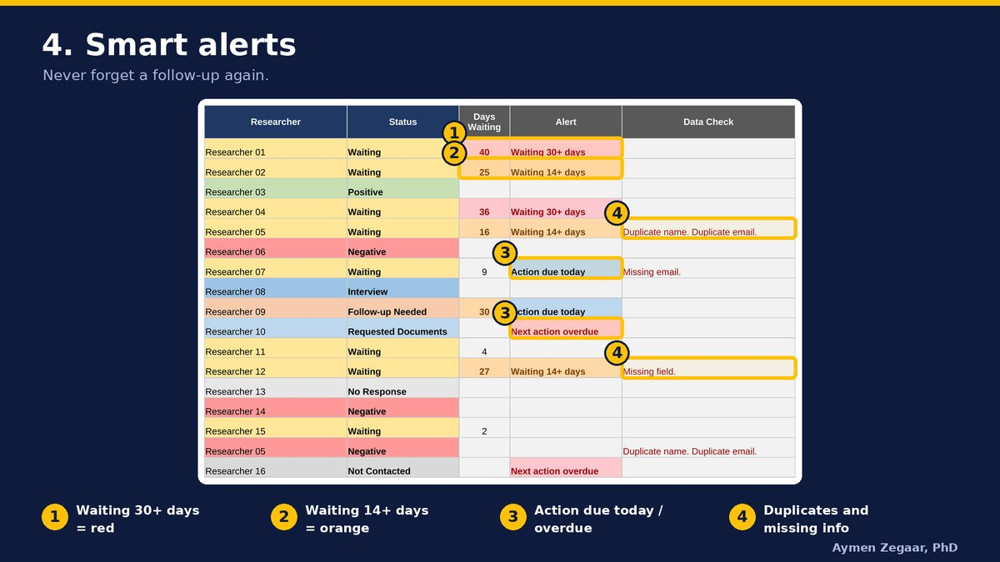
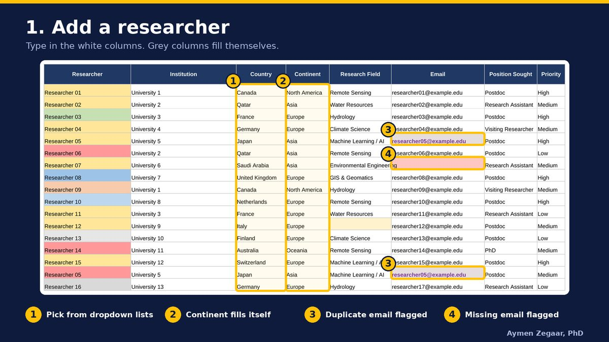

# 📊 Research Position Tracker
[<- Back to Dev Apps](../README.md)

A free **Excel and Google Sheets** template for PhD students and researchers to track postdoc, research-assistant and visiting-researcher applications.

**[Launch Live Page](https://Aymen-ZEGAAR.github.io/GEE-Water-Hub/apps/research-tracker/)**

## Features
* Status dropdowns with automatic colors
* Smart alerts (14 days = orange, 30 days = red), duplicate and missing-email checks
* Live dashboard: response rate, applications per month, by country, field and position type
* Success statistics by country, institution and research field
* Built for 1,000+ researchers, no add-ins or macros

## 📸 Snapshots & Previews

### Live Dashboard

### Visual Charts & Analytics

### Status Dropdowns & Tracking

### Smart Alerts & Checks

### Adding Researchers

